<p align="center">
  
</p>

<h1 align="center">KubeLantern</h1>

<p align="center">
  <strong>AI 原生 Kubernetes SRE 平台</strong><br />
  告警降噪 · 巡检诊断 · 事件闭环 · 值班升级 · AI 治理
</p>

<p align="center">
  <a href="#功能演示"></a>
  <a href="#快速开始"></a>
  <a href="docs/README.md"></a>
</p>

<p align="center">
  
  
  
  
  
  
</p>

<p align="center">
  <sub>让每一次告警都有回声。面向真实 Kubernetes 故障场景的可运行 SRE 工作台。</sub>
</p>

---

<p align="center">
  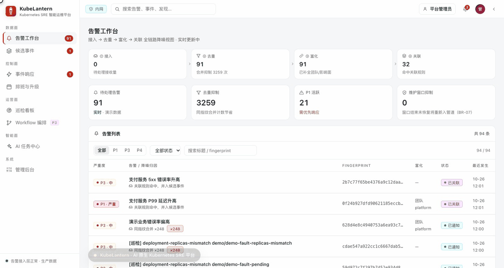
</p>

## 为什么是 KubeLantern

<table>
  <tr>
    <td width="25%" valign="top">
      <b>降噪优先</b><br />
      接入 → 去重 → 富化 → 关联四步管道。同 fingerprint 合并计数，关联规则先产出候选，人工确认后才立项。
    </td>
    <td width="25%" valign="top">
      <b>从巡检到诊断</b><br />
      在真实 3 节点 kind 集群上执行确定性规则扫描；warning 及以上自动转告警，AI 解释带脱敏、预算与调用审计。
    </td>
    <td width="25%" valign="top">
      <b>AI 可控可审计</b><br />
      本地模型优先，外部 OpenAI 兼容模型可选；预算、熔断、审批、调用链只追加，NoAI 时优雅降级。
    </td>
    <td width="25%" valign="top">
      <b>闭环而不是看板</b><br />
      事件 6 态状态机、三级升级、状态页同步与复盘模板；每一次投递、认领和处置都有留痕。
    </td>
  </tr>
</table>

## 功能演示

> 以下 GIF 均录制自本地 3 节点 kind 演示环境，数据为演示数据，不含真实业务信息。  
> 演示环境包含 CrashLoopBackOff、ImagePullBackOff、Pending、PVC 未绑定、副本不一致 5 类真实故障。

### 告警工作台：把噪声变成可处置的信号

<p align="center">
  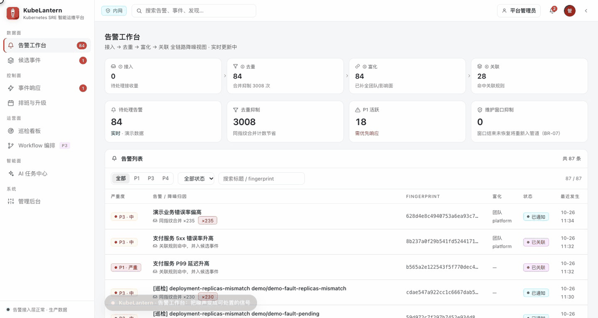
</p>

- **四步管道**：接入、指纹去重、团队/影响面富化、关联规则命中，一屏可见每一步的待处理量。
- **实时性**：SSE 推送新告警，断连时 10s 兜底轮询；状态、合并计数与看板统计同步刷新。
- **处置闭环**：认领（Ack）、关闭、转事件、误报抑制建议；所有操作写入只追加审计。
- **AI 解释**：DeepSeek 外部诊断结果显示在告警详情中，输入已脱敏，模型、tokens 与耗时全量留痕。

### 候选事件：关联规则不直接替你立项

<p align="center">
  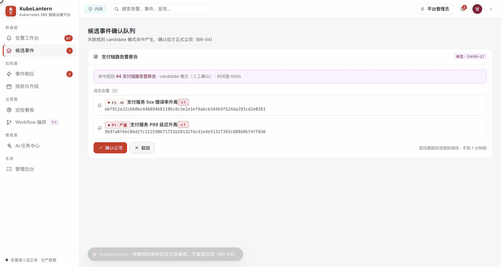
</p>

- 关联规则以 `candidate` 模式运行时，只生成候选并聚合成员告警，不直接创建事件（BR-04）。
- 人工确认后写入事件、关联告警与时间线；驳回原因回流规则调优。
- 同一链路的多条告警在卡片中可回溯到原始告警上下文。

### 事件响应：6 态状态机与完整时间线

<p align="center">
  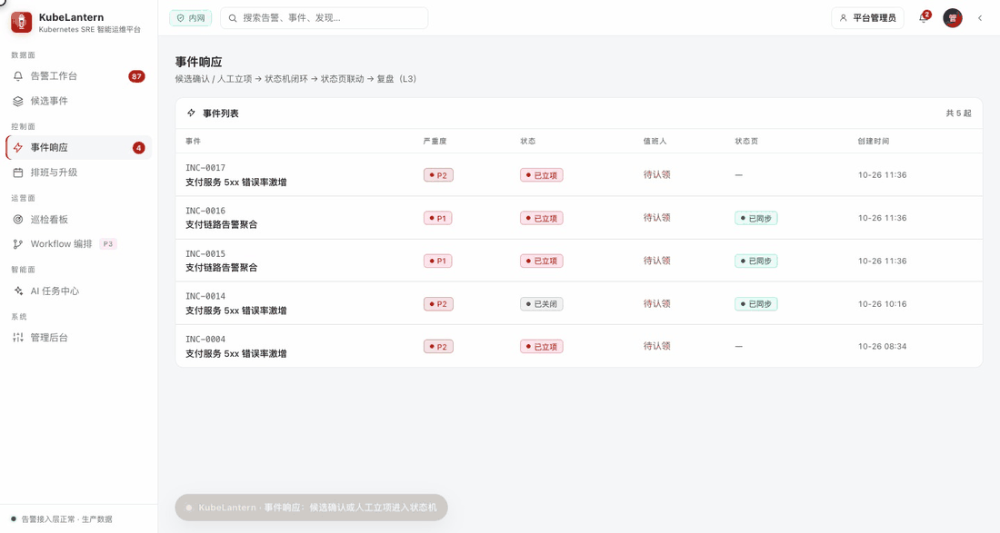
</p>

- `open → acknowledged → mitigated → resolved → closed`，误报走 `cancelled` 并记录原因。
- 状态推进、人工处理记录、通知投递全部进入时间线。
- P1/P2 事件同步状态页，可人工撤回；关闭时生成复盘模板。

### 巡检与 AI：从规则命中到可审计诊断

<p align="center">
  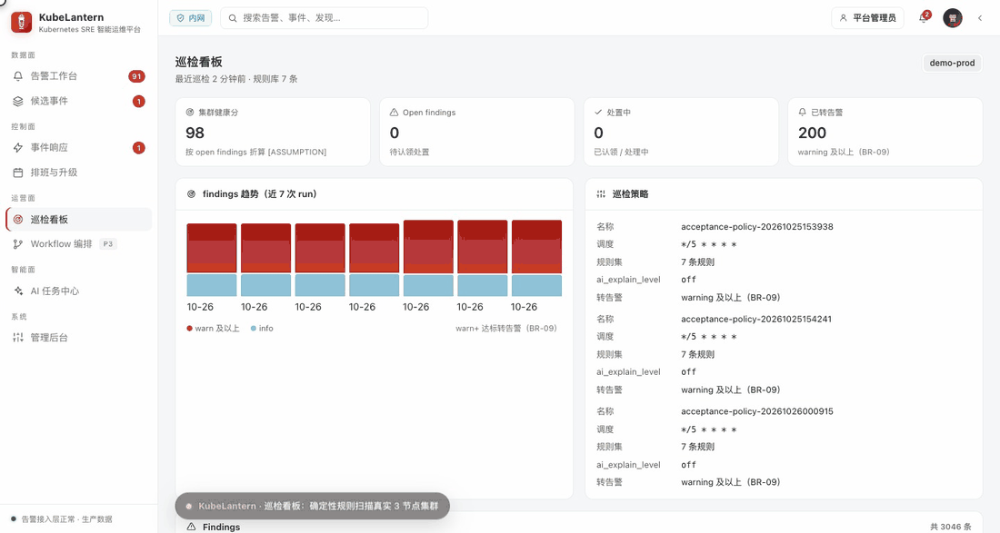
</p>

- 内置 7 条巡检规则，覆盖 Pod 崩溃循环、镜像拉取失败、调度失败、高频重启、PVC 未绑定、副本不一致等。
- 巡检策略支持 cron 调度与 `ai_explain_level`；finding 可认领、忽略、重新打开。
- warning/critical finding 按 BR-09 自动转告警；AI 任务展示预算双维度、状态与调用链。
- 模型不可用时走 NoAI 降级，失败同样留痕，不阻塞告警与巡检主链路。


### AI 审批：预算与工具清单先过人工

<p align="center">
  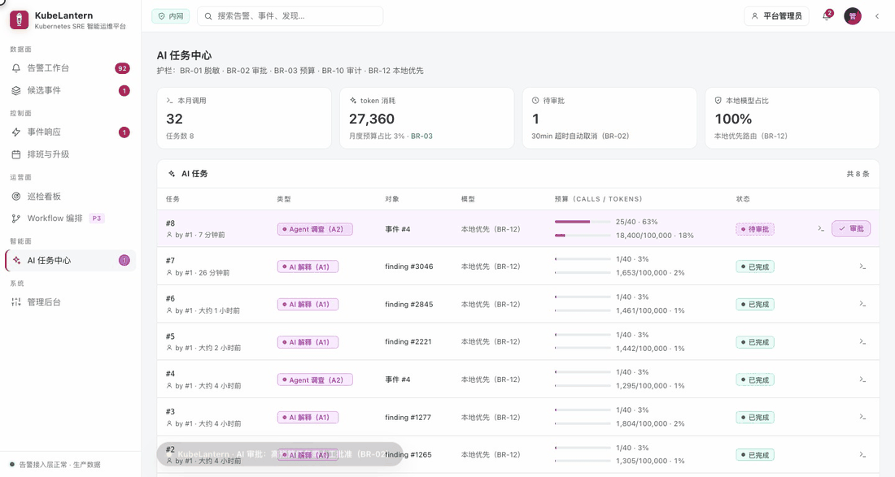
</p>

- 高预算 / 高风险任务进入 `pending_approval`，任务行紫色高亮，侧栏与统计卡同步提示待审批。
- 审批弹窗展示默认只读的工具清单、calls / tokens 预算与审批截止时间。
- 批准后任务进入执行；拒绝或超时（默认 30 分钟）自动取消；决定与调用均写入只追加审计（BR-02 / BR-10）。

### 值班与升级：每次投递都有回执

<p align="center">
  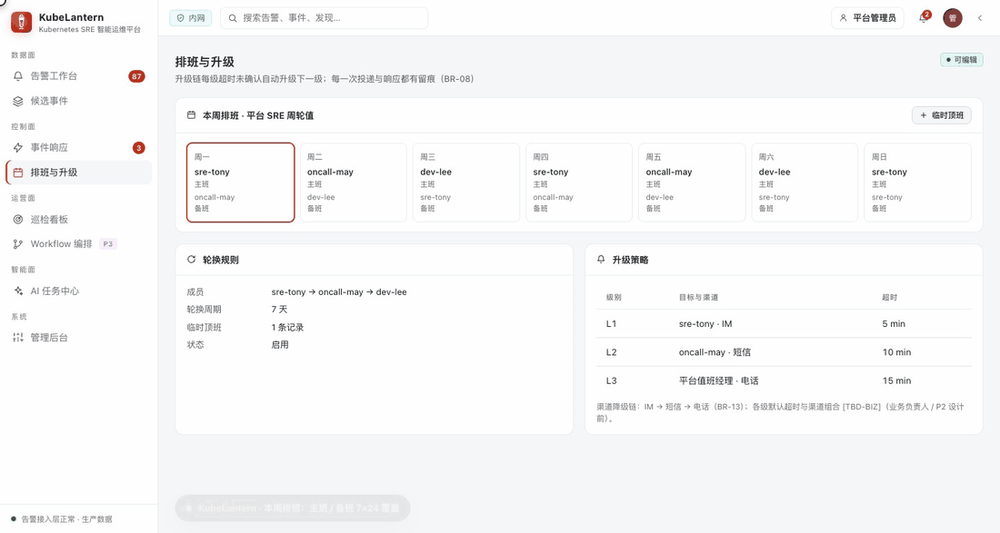
</p>

- 周历展示主班/备班，支持临时顶班并记录事由。
- 升级链按级别、目标、渠道与超时配置；渠道降级链为 IM → 短信 → 电话。
- 排班与升级策略变更计入审计（BR-10）。

### 管理后台：集群、Provider、规则与 RBAC

<p align="center">
  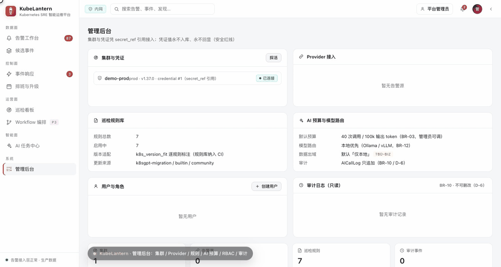
</p>

- 集群凭只读凭证接入，页面只展示 `secret_ref` 引用，凭证值永不入库、永不回显。
- Provider、巡检规则库、AI 预算与模型路由集中管理。
- 5 类角色（admin / sre / oncall_manager / developer / viewer）与团队级行级过滤由后端权威执行。
- 审计日志只追加，不可删改。

### 真实演示环境：React → Java / Python

<p align="center">
  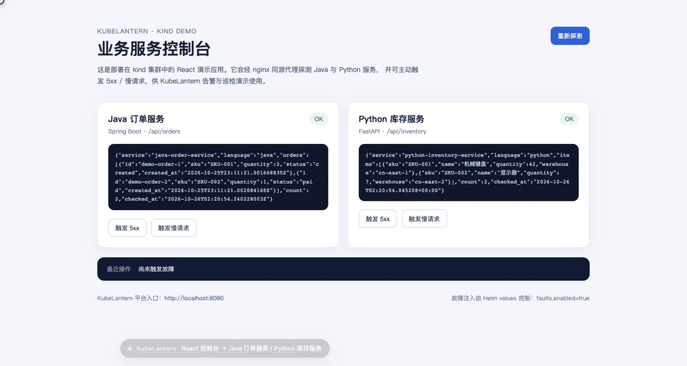
</p>

- 一套 kind 集群内同时运行平台、Java 订单服务、Python 库存服务和 React 控制台。
- 控制台可触发 5xx 与 1.5s 慢请求，用于演练告警、巡检与 AI 诊断链路。
- 故障资源由 Helm values 控制，可一键部署、验收与清理。

### 登录与 RBAC：角色决定边界

<p align="center">
  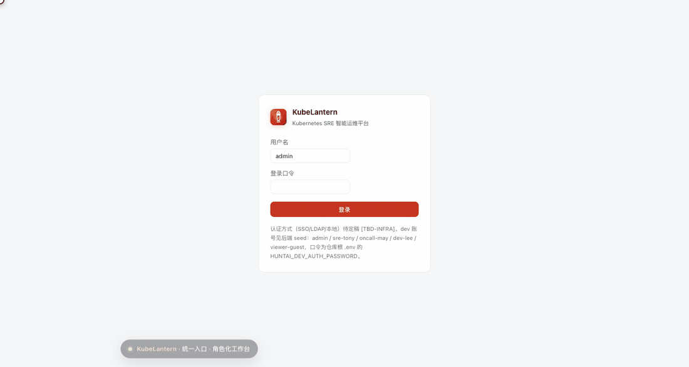
</p>

- 登录后按角色渲染路由与操作；前端只做展示控制，后端权威鉴权。
- 访客访问告警工作台返回 403；研发角色按团队做行级过滤。
- dev 认证为占位实现，正式 SSO/LDAP/本地认证方式 `[TBD-INFRA]`。

## 架构

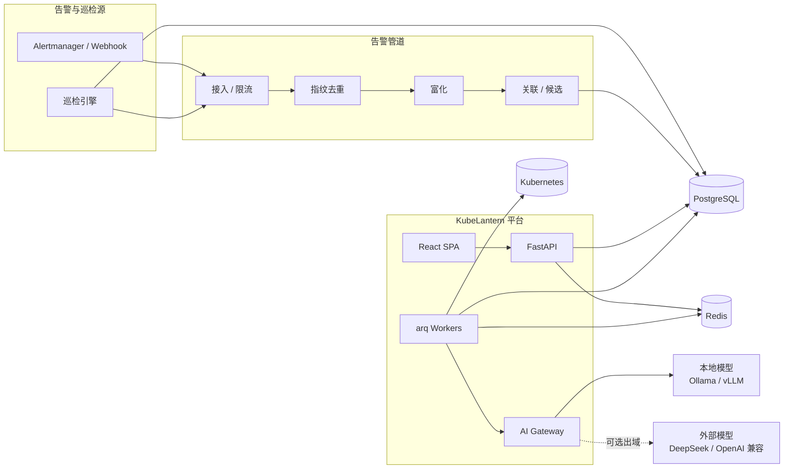

- **模块化单体**：`app/domains/gateway/pipeline/workers/realtime`，按域拆分，API 与 worker 同镜像多角色。
- **先落盘再入队**：告警接入先写 PostgreSQL，再由 arq 推进管道，避免队列丢失。
- **唯一 AI 出域口**：所有模型调用经 AI Gateway，统一做脱敏、预算、熔断与调用留痕。
- **同源部署**：React SPA 与 API 经 nginx 同源代理，SSE 关闭缓冲。

## 技术栈

| 层 | 选型 |
|---|---|
| 后端 | Python 3.12、FastAPI、SQLAlchemy async、arq、Alembic |
| 数据 | PostgreSQL 16、Redis 7 |
| 前端 | React 19、TypeScript、Vite、Tailwind 4、TanStack Query/Table、Zustand |
| 契约 | OpenAPI 3.1 单一事实源，`openapi-typescript` 生成前端类型 |
| 部署 | Docker、Helm、kind、Kubernetes |
| AI | 本地优先（Ollama/vLLM），可选 DeepSeek/OpenAI 兼容外部模型 |

## 能力矩阵

| 能力域 | 关键能力 | 阶段 |
|---|---|---|
| 告警接入 | Webhook、Provider 令牌、限流、指纹去重、富化、关联 | P0 |
| 告警处置 | 认领、关闭、转事件、误报抑制建议、SSE 实时刷新 | P0 |
| 集群接入 | 只读凭证、`secret_ref` 引用、连接探活 | P0 |
| 巡检 | 规则库、策略、手动/定时 run、findings、BR-09 转告警 | P0 |
| 事件 | 候选确认、6 态状态机、时间线、状态页同步、复盘模板 | P2 |
| 值班 | 周排班、轮换、临时顶班、三级升级策略 | P2 |
| AI 治理 | A1 解释、脱敏、预算、审批、熔断、调用链 | P1 |
| AI 扩展 | A2 事件调查、A3 Workflow 生成（P3 薄层） | P3 |
| 权限 | admin / sre / oncall_manager / developer / viewer + 团队行级过滤 | P0 |
| 演示环境 | 3 节点 kind、Helm、Java/Python/React 示例、故障注入、14 项验收 | P0 |

## 快速开始

前置条件：Docker Desktop（建议 8 核 / 12 GB 以上）、`kind`、`kubectl`、`helm`、`python3`、`curl`。

```bash
git clone https://github.com/Mylifeforrent/kubelantern.git
cd kubelantern

bash deploy/scripts/00-prereqs.sh
bash deploy/scripts/01-create-cluster.sh
bash deploy/scripts/02-build-images.sh
bash deploy/scripts/03-deploy-platform.sh
bash deploy/scripts/04-deploy-demo.sh
bash deploy/scripts/05-run-acceptance.sh
```

完成后：

- KubeLantern 平台：<http://127.0.0.1:8080>（演示账号 `admin`，口令见 `.env` 的 `HUNTAI_DEV_AUTH_PASSWORD`）
- 演示业务控制台：<http://127.0.0.1:18081>
- 外部 AI（可选）：在 `.env` 填入 DeepSeek key 后执行 `bash deploy/scripts/07-configure-ai.sh`

完整的环境说明、构建细节、验证命令与排障步骤见 [DEVELOPMENT.md](DEVELOPMENT.md) 与 [deploy/README.md](deploy/README.md)。

## 安全与治理

- **凭据**：真实凭据只放 `.env` 或密钥管理服务；代码、文档、命令与日志只使用 `$ENV_VAR` 或占位符。
- **最小权限**：集群接入使用只读 ServiceAccount token；页面只展示 `secret_ref`，不回显凭证值。
- **AI 数据边界**：默认本地模型；外部模型需显式开启，输入先脱敏，调用经预算与熔断。
- **审计**：告警、事件、排班、AI 调用与配置变更均写入只追加审计日志（BR-10）。
- **提交护栏**：仓库自带 pre-commit 凭据扫描；禁止 `git commit --no-verify`。

## 文档

- [文档地图与状态台账](docs/README.md)
- [PRD：产品全貌与开放问题](docs/02-business-design/05-prd.md)
- [整体架构设计（HLD）](docs/03-tech-design/02-architecture.md)
- [API 契约（OpenAPI 3.1）](docs/04-api/README.md)
- [功能验收与手工体验](docs/06-release/03-feature-acceptance.md)
- [全功能自测操作手册（HTML）](docs/06-release/05-self-test-handbook.html)
- [开发与部署指南](DEVELOPMENT.md)

> 代码中的 Python 包名与部分历史文档仍使用内部代号 `huntai`，属于实现细节；对外产品名为 **KubeLantern**。

## License

[MIT](LICENSE) © 2026 Tony

<p align="center">
  <sub>Built for SRE teams who want fewer alarms and faster answers.</sub>
</p>
