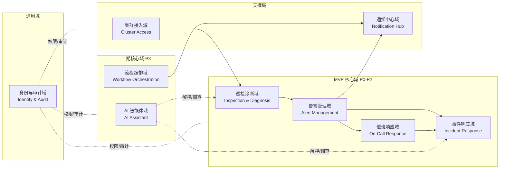
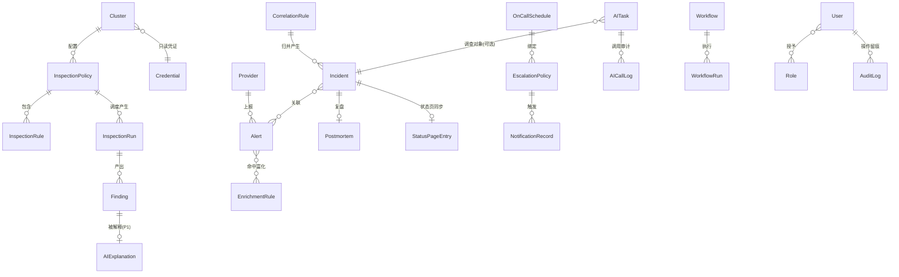
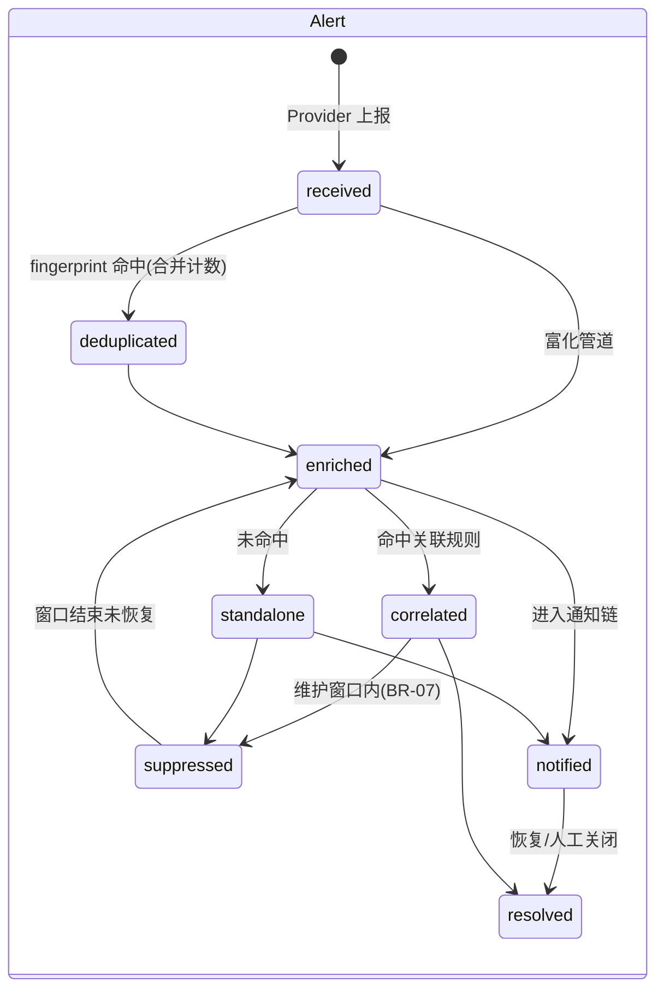
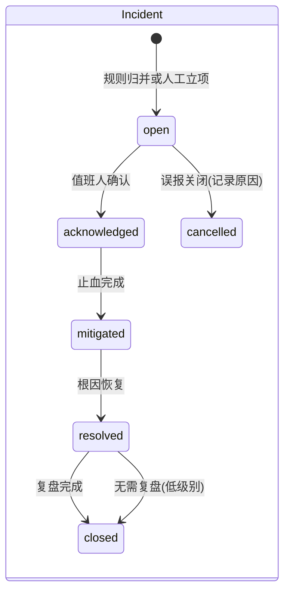
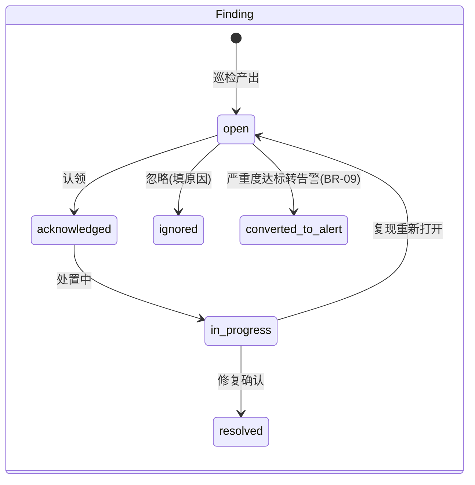
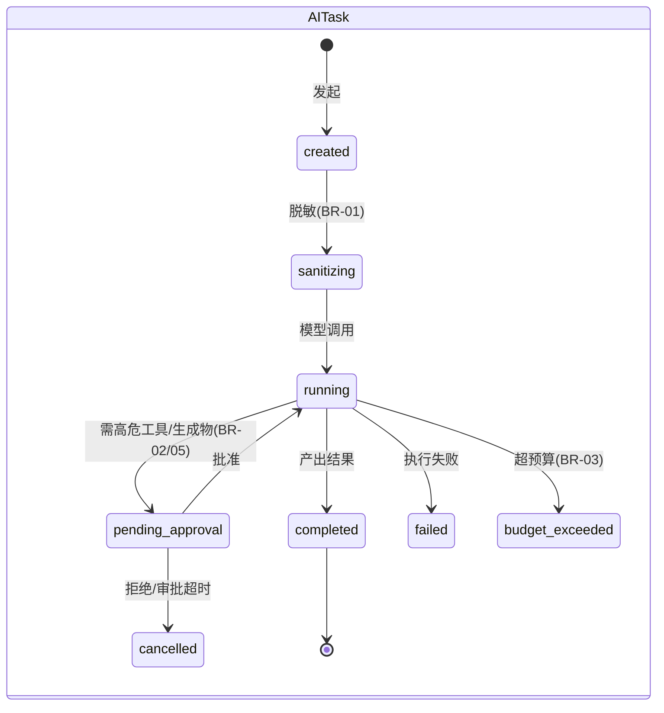
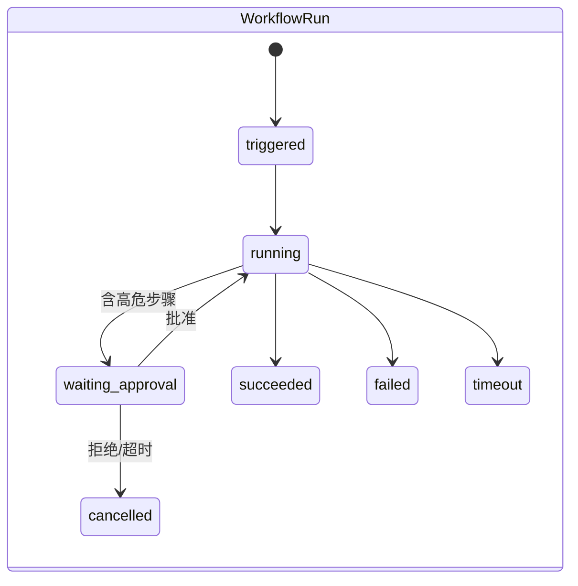

# 业务建模：领域模型与业务规则

| 元信息 | |
|---|---|
| 状态 | accepted |
| 日期 | 2026-10-24 |
| 依据 | `01-research/01-benchmark-report.md`（对标结论与 P0-P4 路线图） |
| 读者 | 产品、SRE、后端/前端研发 |
| 关联 | `02-interaction-flows.md`（交互链路，与本文档同批评审） |

---

## 1. 业务背景与目标

企业内部需要一个基于 Kubernetes 的 SRE 运维平台，解决四个核心痛点（依据对标报告第 0 节）：

1. 告警分散、噪声大 → 统一接入 + 去重降噪 + 关联成事件；
2. 集群问题依赖人工经验 → 规则化巡检 + AI 解释；
3. 值班响应无流程保障 → on-call 排班 + 升级链 + 通知审计；
4. AI 落地无安全边界 → 窄权限 + 确定性外壳的 AI 能力体系。

**建设原则**（贯穿所有领域）：先确定性、后 AI；AI 一律「窄权限 + 确定性外壳 + 人在回路」（护栏见 BR-01 ~ BR-12）。

## 2. 业务范围与分期

对标报告的 P0-P4 分期即本平台业务范围的分解，本文档按「P0-P2 = MVP 核心，P3 = 二期，P4 = 远期」建模。

| 分期 | 业务能力 | 建模范围 |
|---|---|---|
| P0 | 多集群接入、集群体检引擎、告警接入与去重 | 本文 §4-§7 全量 |
| P1 | AI 诊断解释、脱敏、多模型抽象 | 本文 §4-§7 全量 |
| P2 | On-call 排班与升级、事件生命周期、状态页联动、告警关联、拨测 | 本文 §4-§7 全量 |
| P3 | Agent 自动调查、Workflow 编排、AI 生成编排、定时巡检强化 | 本文 §4-§7 全量（远期实体标注 P3） |
| P4 | AI 修复 PR 闭环、窄路径自动处置 | 仅 §7 业务规则涉及，实体暂不细化 |

**Out of scope**（不在本平台范围）：日志/指标/trace 的采集与存储（复用企业已有 Prometheus/Grafana/Loki `[TBD-INFRA]`）；工单系统自建（对接企业已有工单 `[TBD-BIZ]`）。

## 3. 角色与权限

角色定义 `[ASSUMPTION]`（默认按小团队扁平结构建模，企业组织架构对接方式待确认，验证方式：与平台首批使用团队访谈）：

| 角色 | 英文标识 | 职责 | 关键权限 |
|---|---|---|---|
| 平台管理员 | `admin` | 平台配置、集群与凭证、用户与角色、AI 预算策略、写操作审批开关 | 全部管理权限 |
| SRE 工程师 | `sre` | 告警/事件处置、巡检认领、AI 工具使用、Workflow 编排 | 告警/事件/巡检读写；集群只读；AI 任务发起与审批（限本团队） |
| 值班经理 | `oncall_manager` | 排班表、升级策略、通知渠道维护 | 排班/升级策略读写；事件只读 |
| 研发工程师 | `developer` | 查看本团队服务的告警/事件/巡检发现，认领 finding | 本团队资源只读 + finding 认领；无 AI 审批权 |
| 访客 | `viewer` | 查看状态页与公开看板 | 只读（限公开范围） |

权限矩阵（资源 × 动作，Y=允许，N=拒绝，T=限本团队）：

| 资源 \ 动作 | admin | sre | oncall_manager | developer | viewer |
|---|---|---|---|---|---|
| 集群配置 / 凭证管理 | Y | N | N | N | N |
| 集群数据只读（kubectl get/logs） | Y | Y | N | T | N |
| 告警：查看 / 认领 / 关闭 | Y / Y / Y | Y / Y / Y | Y / N / N | T / T / N | N |
| 事件：立项 / 处置 / 关闭 | Y | Y | N | T（限本团队事件） | N |
| 巡检：策略配置 / finding 处置 | Y / Y | Y / Y | N / N | N / T（认领） |
| 排班 / 升级策略管理 | Y | N | Y | N | N |
| AI 任务：发起 / 审批 / 查看审计 | Y / Y / Y | Y / T / Y | N / N / N | N / N / N |
| Workflow：编辑 / 执行 / 审批 AI 生成 | Y / Y / Y | Y / Y / Y | N / N / N | N / N / N |
| 状态页：编辑 / 发布 | Y | Y | N | N | N |

> 写操作（对集群的一切变更类动作）在权限之外还需通过审批流（BR-02），权限矩阵只表达「谁可以发起」。

## 4. 领域划分（子域地图）

| 子域 | 职责一句话 | 关键参考（对标报告） |
|---|---|---|
| 告警管理域 | 告警统一接入、去重、富化、关联，输出「少量高质事件」 | Keep provider / fingerprint / correlation |
| 巡检诊断域 | 确定性规则扫描集群，产出结构化 finding | k8sgpt analyzer 体系 |
| 事件响应域 | 事件全生命周期与状态页联动、复盘 | OneUptime incident |
| 值班响应域 | 排班、升级链、通知审计 | OneUptime on-call |
| AI 智能体域 | 脱敏、模型路由、AI 任务（解释/调查/生成编排）、预算与审批 | 四项目护栏模式 |
| 流程编排域 | YAML 声明式自动化编排（P3） | Keep workflow 引擎 |
| 集群接入域 | 多集群只读凭证与连接健康 | HolmesGPT 只读基线 |
| 通知中心域 | 多渠道（IM/短信/电话 `[TBD-BIZ]`）投递与记录 | Keep provider 出站 |
| 身份与审计域 | 用户、角色、全量操作审计 | 平台基础 |

## 5. 核心实体与关系

### 5.1 实体字典

| 实体 | 英文标识 | 关键属性 | 分期 | 说明 |
|---|---|---|---|---|
| 集群 | `Cluster` | name, environment, api_endpoint, status, k8s_version | P0 | 对接目标集群，凭证不落库（引用密钥管理） |
| 凭证 | `Credential` | ref, scope(readonly/write), expires_at | P0 | 默认只有 readonly 凭证（BR-02） |
| 告警源提供方 | `Provider` | type, category(source/query/action), pull_mode(push/poll), fingerprint_fields | P0 | 三类角色统一抽象（Keep 范式） |
| 告警 | `Alert` | fingerprint, severity, labels, raw_payload, status, occurred_at | P0 | 去重以 fingerprint 为主键维度 |
| 富化规则 | `EnrichmentRule` | matchers, mappings(extraction/mapping) | P0 | 告警到达时自动补全 team/影响面等 |
| 关联规则 | `CorrelationRule` | conditions(AND/OR), time_window, mode(auto/候选) | P2 | mode=候选 时必须人工确认（BR-04） |
| 事件 | `Incident` | title, severity(P1-P4), status, status_page_sync | P2 | 告警归并 + 人工立项的处置单元 |
| 复盘报告 | `Postmortem` | timeline, root_cause, action_items[{owner,due,status}] | P2 | blameless，模板生成 |
| 状态页条目 | `StatusPageEntry` | visibility(public/internal), updates[] | P2 | 事件状态自动同步（BR-06） |
| 巡检规则 | `InspectionRule` | code, category, severity_default, k8s_version_fit, enabled | P0 | SRE 经验代码化（k8sgpt analyzer 移植） |
| 巡检策略 | `InspectionPolicy` | cluster_scope, rule_set, schedule, ai_explain_level | P0 | ai_explain_level 控制哪些级别触发 AI（BR-09） |
| 巡检执行 | `InspectionRun` | started_at, finished_at, result, findings_count | P0 | 只读执行记录 |
| 巡检发现 | `Finding` | rule_code, resource_ref, severity, raw_error(结构化), status | P0 | 确定性产出，是 AI 解释的输入 |
| AI 解释 | `AIExplanation` | finding_id, sanitized_input_digest, output, model, tokens | P1 | 范式 A 产物（k8sgpt 模式） |
| AI 任务 | `AITask` | type(explain/investigate/workflow_gen), status, context_refs, budget, requires_approval | P1/P3 | 预算与审批的载体（BR-03/BR-05） |
| AI 调用日志 | `AICallLog` | task_id, tool_used, prompt_digest, tokens, latency, result_code | P1 | 全量审计（BR-10） |
| 排班表 | `OnCallSchedule` | team, rotation_rules, calendar, overrides | P2 | 轮换 + 临时顶班 |
| 升级策略 | `EscalationPolicy` | levels[{target, channel, timeout_min}] | P2 | 多级升级链定义 |
| 通知记录 | `NotificationRecord` | channel, target, content_digest, status, ack_action, ack_at | P2 | 每一步投递与响应的审计 |
| 编排定义 | `Workflow` | yaml, version, source(manual/ai_generated), approved_by | P3 | AI 生成必须人确认（BR-05） |
| 编排执行 | `WorkflowRun` | trigger_type(alert/manual/schedule), status, steps_log | P3 | 执行实例 |
| 用户 / 角色 / 审计日志 | `User` / `Role` / `AuditLog` | — | P0 | 身份与审计域 |

### 5.2 标识与命名约定

- 所有实体主键为平台内部 ID；对外展示用业务键（如 Alert 用 `fingerprint`，Finding 用 `rule_code + resource_ref + run_id`）。
- 时间一律 UTC 存储、前端本地化展示。

## 6. 核心状态机

## 7. 业务规则（BR-xx，唯一事实源）

> 其他文档引用规则时只写编号。规则的护栏出处见 `01-research/01-benchmark-report.md` §5。

| 编号 | 规则 | 分期 | 出处/理由 |
|---|---|---|---|
| BR-01 | 所有发往外部模型的内容必须先脱敏（掩码可逆映射仅存本地）；默认开启，不可全局关闭 | P1 | k8sgpt anonymization；数据合规 |
| BR-02 | 平台对 K8s 的访问默认只读；一切写操作必须独立审批流 + 管理员显式开启 | P0 | HolmesGPT 只读基线 |
| BR-03 | 每个 AI 任务必须有预算上限（默认 40 次调用 / 100k 输出 token，管理员可调）；超限优雅降级为部分结论并标注 | P1 | OneUptime 工程控制 |
| BR-04 | 关联规则产生的「候选事件」必须人工确认后才正式立项；auto 模式仅对已运行 ≥30 天且零误报的规则开放 `[TBD-BIZ]` | P2 | Keep 候选审批灰度机制 |
| BR-05 | AI 生成的 Workflow/修复建议只具有「提议」地位，人工确认前不得执行 | P3 | Keep Workflow Builder 人在回路 |
| BR-06 | P1/P2 事件状态变更自动同步状态页；同步动作可人工撤回 | P2 | OneUptime 状态页联动 |
| BR-07 | 维护窗口内的相关告警自动抑制并完整记录，窗口结束未恢复则重新进入管道 | P2 | OneUptime 维护窗口 |
| BR-08 | 升级链每级超时未确认自动升级下一级；每一次投递与响应都产生 NotificationRecord | P2 | OneUptime 升级链审计 |
| BR-09 | 巡检发现按严重度分流：info 只入看板不触发 AI；warn 以上转告警并可触发 AI 解释（按 policy 的 ai_explain_level） | P0/P1 | LLM 成本分级（对标报告 §6.4） |
| BR-10 | 全部写操作与 AI 调用留全量审计（who / when / what / cost），审计日志不可删改 | P0 | HolmesGPT OTel 审计链 |
| BR-11 | 自动修复（P4）默认关闭；开启需 admin 审批 + 仅限白名单窄路径（LLM 不持有写权限，由确定性层计算变更并 dry-run） | P4 | k8sgpt auto-remediation |
| BR-12 | AI 模型路由支持本地模型（Ollama/vLLM）；是否允许数据出域由管理员配置，默认「仅本地」`[TBD-BIZ]` | P1 | 四项目共同实践 |
| BR-13 | 通知渠道优先级与降级链可配置（如 IM 失败转短信 `[TBD-BIZ]`）；渠道全失败时升级链继续走下一级目标 | P2 | 通知可靠性 |

## 8. 非功能约束

| 维度 | 约束 | 标记 |
|---|---|---|
| 数据边界 | 默认数据不出域；外部模型使用需显式配置 | BR-12 |
| 凭据安全 | 集群凭证、Provider 凭据不入库不入日志，引用密钥管理 | 项目安全红线 |
| 可用性 | 平台自身故障不得影响告警接收（接入层至少落盘暂存） | `[TBD-INFRA]` 部署形态确认后细化 |
| 性能 | 告警接入管道 P95 < 3s（从上报到入库）；巡检执行不阻塞告警管道 | `[ASSUMPTION]` 待容量规划验证 |
| 成本 | LLM 成本按任务类型分级（巡检解释用小模型、事件调查用强模型），月度成本看板 | 对标报告 §6.4 |

## 9. 开放问题（待确认清单）

| 标记 | 问题 | 确认人 / 阶段 |
|---|---|---|
| `[TBD-BIZ]` | 通知渠道组合（钉钉/企微/短信/电话）与升级链各级默认超时 | 业务负责人 / P2 设计前 |
| `[TBD-BIZ]` | 数据出域政策与可用模型清单 | 安全合规负责人 / P1 设计前 |
| `[TBD-BIZ]` | 团队/服务归属数据源（CMDB 对接 or 平台自维护） | 业务负责人 / P0 设计前 |
| `[TBD-BIZ]` | 状态页受众（对外客户 or 对内） | 业务负责人 / P2 设计前 |
| `[TBD-INFRA]` | 已有可观测栈（Prometheus/Grafana/Loki）与工单系统对接方式 | 基础设施负责人 / P0 设计前 |
| `[TBD-UX]` | developer 角色按团队隔离的数据边界展示方式 | UX / P2 设计前 |
| `[ASSUMPTION]` | 角色按 §3 五类建模（小团队扁平结构） | 首批使用团队访谈验证 |
