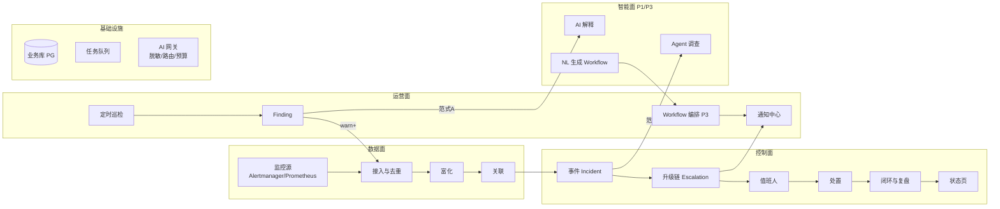
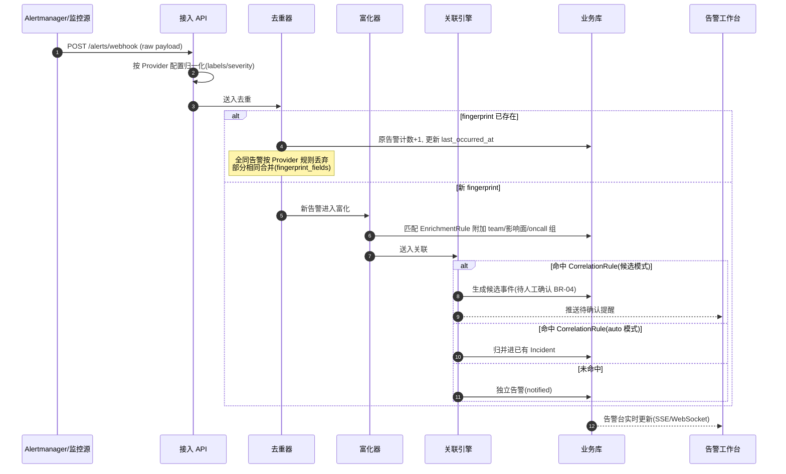
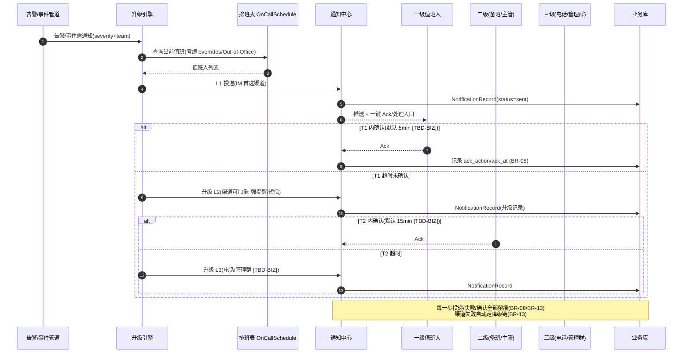
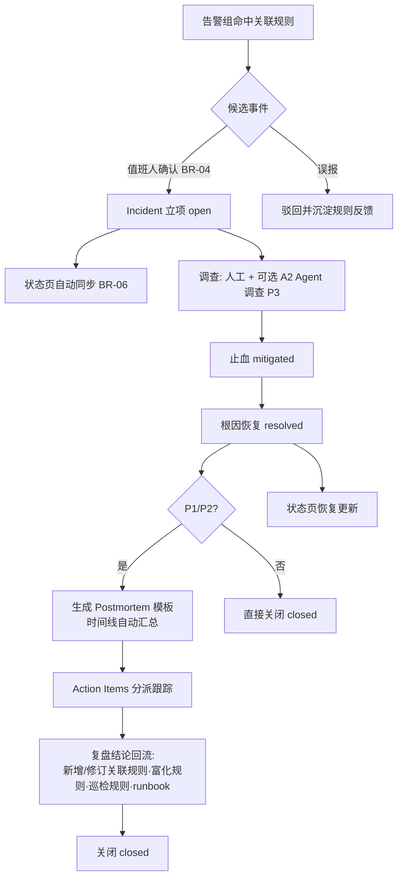
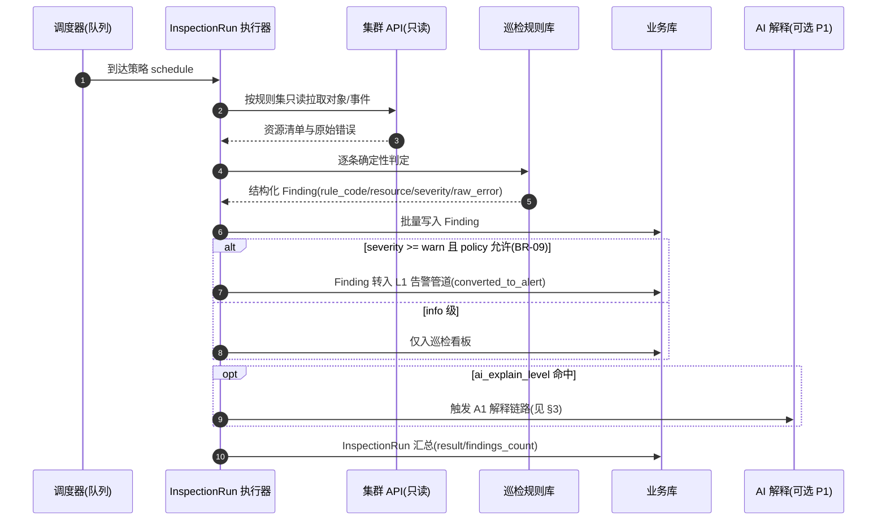
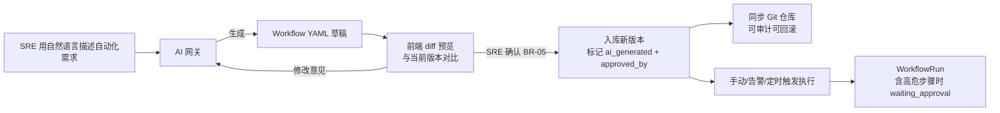

# 交互链路设计

| 元信息 | |
|---|---|
| 状态 | draft（待评审） |
| 日期 | 2026-10-24 |
| 依据 | `01-research/01-benchmark-report.md`（AI 范式与护栏）、`01-domain-model.md`（实体与 BR 规则） |
| 读者 | 产品、SRE、后端/前端研发 |
| 关联 | 实体与业务规则编号（BR-xx）均定义在 `01-domain-model.md`，本文只引用 |

---

## 1. 链路总览

平台交互链路分四个面：**数据面**（告警管道）、**控制面**（值班与事件）、**智能面**（AI 能力）、**运营面**（巡检与编排）。主干线是「监控源 → 告警管道 → 事件 → 值班响应 → 闭环复盘」。



## 2. 主链路设计（确定性，P0-P2）

### L1 告警接入与降噪链路（P0/P2）

告警从监控源到达平台后，依次经过**接入 → 去重 → 富化 → 关联**四段固定顺序的管道（顺序不可调换，各段职责单一，参考 Keep 摄入流水线）。



设计要点：
- **接入层可用性**：webhook 接收与管道解耦（先落库/队列再处理），平台故障不丢告警（非功能约束 §8）。
- **去重两级**：全同丢弃（防风暴）+ 部分合并（fingerprint 可见性），字段来源 Provider 配置。
- **富化是关联的前置**：关联条件常依赖富化出的 team/severity 字段。

### L2 值班通知与升级链路（P2）



### L3 事件处置与闭环链路（P2）



### L4 定时巡检链路（P0）



## 3. AI 链路设计（智能面，P1/P3）

三条 AI 链路分别对应对标报告的三种范式，全部受 §7 业务规则约束。

### A1 AI 诊断解释链路（范式 A：规则找问题、AI 解释问题，P1）

```mermaid
sequenceDiagram
    autonumber
    participant F as Finding
    participant SAN as 脱敏器
    participant GW as AI 网关(模型路由)
    participant LLM as 模型(本地优先 BR-12)
    participant DB as 业务库
    participant IM as IM 渠道

    F->>SAN: raw_error + 资源上下文(仅错误片段,非全量)
    SAN->>SAN: 掩码 namespace/pod/IP/密钥类字段(BR-01)
    SAN->>GW: 脱敏后文本 + 任务类型=explain
    GW->>GW: 模型路由(小模型)+ 预算检查(BR-03)
    GW->>LLM: 调用(附巡检规则说明,可附文档片段)
    LLM-->>GW: 诊断 + 修复建议(结构化)
    GW->>SAN: 结果回填
    SAN->>DB: 本地掩码还原后存 AIExplanation
    SAN-->>IM: 推送摘要(带跳转链接)
    Note over GW,DB: 失败重试 1 次;NoAI 模式直接透出原始错误<br/>每次调用写 AICallLog(BR-10)
```

**为什么先做这条**：幻觉面最小、成本最低、可复现（对标报告范式 A 结论），是平台 AI 能力的性价比切入点。

### A2 Agent 自动调查链路（范式 B：Agent 循环，P3）

```mermaid
sequenceDiagram
    autonumber
    participant INC as Incident
    participant CTX as 上下文构造器
    participant AG as Agent 循环
    participant TOOLS as 只读工具集
    participant SRE as SRE(审批人)
    participant DB as 业务库

    INC->>CTX: 触发(手动/规则, P1/P2 事件)
    CTX->>CTX: 汇聚关联告警+Finding+拓扑标签+最近变更
    CTX->>AG: 初始上下文(脱敏 BR-01)
    loop 直至产出 RCA 或预算耗尽(BR-03)
        AG->>TOOLS: 选择工具(如 kubectl describe/logs --tail, promql 查询)
        alt 只读工具
            TOOLS-->>AG: 结果(输出截断与内存上限治理)
        else 高危工具(exec/写类)
            AG->>DB: 挂起 pending_approval
            DB-->>SRE: 审批通知
            SRE-->>AG: 批准/拒绝(默认 30min 超时=拒绝)
        end
    end
    AG->>DB: RCA 报告(每个结论带证据引用: 工具调用+原始输出)
    DB-->>INC: 回写事件时间线 + 通知值班人
    Note over AG,DB: 全过程 AICallLog 留痕(BR-10);<br/>预算耗尽输出部分结论并标注未完成
```

**工具集安全边界**：默认只内置只读工具；工具定义采用 YAML toolset 机制（对标 HolmesGPT），新工具由 admin 审核后注册，每个工具带输出大小上限。

### A3 自然语言生成 Workflow 链路（范式 C：NL→YAML，P3）



## 4. 人机交互设计（界面信息架构）

> 角色与权限见 `01-domain-model.md` §3；此处只定义关键页面的信息架构与主操作流 `[TBD-UX]`（线框图待 UX 评审后补充）。
> 可点击原型：`03-clickable-prototype.html`（Keep 风格暗色版，单文件无构建依赖，覆盖下表关键页面与 §4.2 关键操作流，演示数据为虚构）。

### 4.1 关键页面

| 页面 | 核心信息 | 主操作 | 主要角色 |
|---|---|---|---|
| 告警工作台 | 告警列表（fingerprint 合并计数、severity 筛选）、侧栏详情（原始 payload + 富化字段 + 关联事件 + AI 解释） | 认领 / 关闭 / 转事件 / 查看降噪归因（为何合并、为何升级） | sre |
| 事件详情页 | 时间线（自动+人工）、关联告警、值班与升级状态、AI 调查报告（P3）、状态页同步状态 | 确认 / 止血 / 恢复 / 同步撤回 / 发起 Agent 调查（P3） | sre |
| 候选事件确认队列 | 关联规则产出的候选事件 + 命中证据 | 确认立项 / 驳回（驳回原因回流规则反馈） | sre |
| 巡检看板 | 按集群/规则聚合的 Finding、趋势 | 认领 / 忽略 / 一键 AI 解释 | sre, developer(T) |
| AI 任务中心 | 任务列表、状态（含 pending_approval）、预算消耗、调用审计 | 审批 / 取消 / 查看调用链 | sre, admin |
| Workflow 编辑器（P3） | YAML 编辑 + 可视化、版本历史、diff 预览 | 新建 / NL 生成（A3）/ 执行 / 审批 | sre |
| 排班管理 | 日历视图、轮换规则、临时顶班 | 编辑排班 / 配置升级策略 | oncall_manager |
| 管理后台 | 集群与凭证、Provider、巡检规则库、用户角色、AI 预算策略、模型路由 | 全部管理操作 | admin |

### 4.2 关键操作流

**告警处置流**（sre 主路径）：收到通知（IM 卡片）→ 点入告警详情 → 查看 AI 解释（P1 起）→ 认领（Ack，升级链停止）→ 一键转事件或直接关闭 → 若误报，标记「抑制建议」，进入降噪规则反馈池。

**候选事件确认流**（BR-04 人机协作）：候选事件卡片展示「命中规则 + 成员告警列表 + 相似度」→ sre 确认（立项）或驳回（选择驳回原因：规则过宽 / 时间窗过长 / 富化字段错误）→ 驳回原因作为规则调优输入。

**AI 审批流**（BR-02/BR-05）：AI 任务挂起 → AI 任务中心 + IM 通知审批人 → 展示「将要执行的工具与参数、预算已消耗」→ 批准（任务继续）/ 拒绝（任务终止，上下文留存）。

## 5. 链路与分期映射

| 链路 | P0 | P1 | P2 | P3 | P4 |
|---|---|---|---|---|---|
| L1 告警接入与降噪 | 接入+去重+富化 | — | 关联 | — | — |
| L2 值班通知与升级 | — | — | 全量 | — | — |
| L3 事件处置与闭环 | — | — | 全量（不含 Agent） | Agent 调查接入 | — |
| L4 定时巡检 | 全量（无 AI） | 接入 A1 | — | 巡检项 NL 化 | — |
| A1 AI 解释 | — | 全量 | — | — | — |
| A2 Agent 调查 | — | — | — | 全量 | — |
| A3 NL 生成 Workflow | — | — | — | 全量 | — |
| AI 修复 PR 闭环 | — | — | — | — | 规划（BR-11 约束） |

## 6. 异常与降级路径

| 异常场景 | 降级行为 | 依据 |
|---|---|---|
| AI 网关 / 模型不可用 | A1/A2/A3 自动熔断为 NoAI 模式：透出原始错误与人工入口；AI 状态在界面显著标识 | 对标报告 k8sgpt NoOpAI |
| 单渠道通知失败 | 按 Provider 配置自动走降级链（IM → 短信 → 电话 `[TBD-BIZ]`）；全失败则升级链直接进入下一级目标 | BR-13 |
| 审批超时（默认 30min） | AI 任务自动取消并通知发起人，上下文留存可重发 | BR-02/BR-05 |
| 集群连接失败 | 接入域探活告警（平台自监控），巡检任务标记 failed 并通知 admin | 平台自监控 |
| 告警管道积压 | 入口限流 + 落盘暂存，恢复后按序回放；积压超阈值通知 admin | 非功能约束（可用性） |
| AI 预算耗尽 | 任务 graceful 终止，输出部分结论并显式标注「未完成」 | BR-03 |

## 7. 开放问题

| 标记 | 问题 | 确认人 / 阶段 |
|---|---|---|
| `[TBD-UX]` | 告警工作台信息密度与降噪归因展示方式（合并原因可视化） | UX / P0 前端设计前 |
| `[TBD-BIZ]` | 升级链各级默认超时与渠道组合（影响 L2 细节） | 业务负责人 / P2 设计前 |
| `[TBD-BIZ]` | 状态页对外发布流程是否需要审批 | 业务负责人 / P2 设计前 |
| `[TBD-FE]` | 实时更新通道选型（SSE vs WebSocket） | 前端 / P0 技术设计时 |
| `[ASSUMPTION]` | A2 审批默认超时 30min、A1 失败重试 1 次为建模默认值 | P3 上线前用真实任务校准 |
