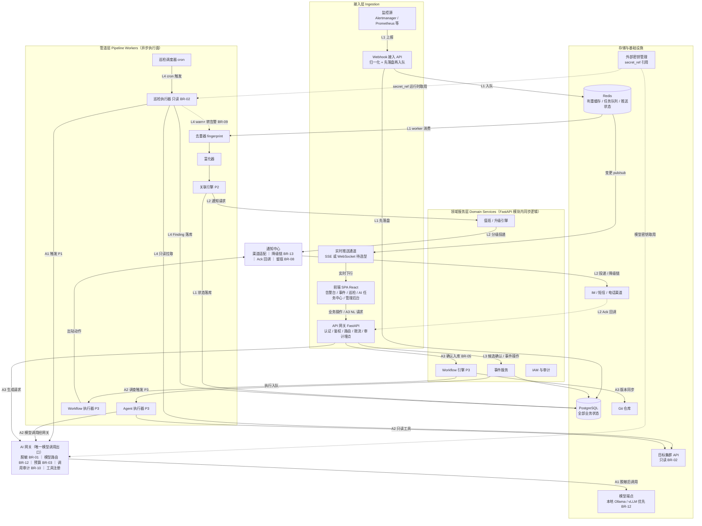

# 整体架构设计（HLD）

| 元信息 | |
|---|---|
| 状态 | accepted |
| 日期 | 2026-10-24 |
| 依据 | `01-research/01-benchmark-report.md`（技术架构、AI 护栏、成本分级）、`02-business-design/01-domain-model.md`（子域地图 §4、BR-01~13、非功能约束 §8）、`02-business-design/02-interaction-flows.md`（L1-L4/A1-A3 链路与 §6 异常降级）、`03-tech-design/01-data-model.md`（存储与数据层定稿） |
| 读者 | 全部研发 · SRE |

> 业务规则只引用 BR-xx 编号，唯一事实源为 `02-business-design/01-domain-model.md` §7。数据层（表结构、索引、分区、保留策略）唯一事实源为 `03-tech-design/01-data-model.md`，本文不重复其内容，只引用结论。本文中的技术演绎凡上游文档未规定者，均以 `[ASSUMPTION]`（附验证方式）或 `[TBD-*]` 标注。

---

## 1. 架构总览

### 1.1 分层架构图

架构分六层：**接入层 → 管道层 → 领域服务层 → AI 网关 → 通知中心 → 存储与基础设施**。风格为模块化单体 + worker（§6），对标报告 §6.2 第 1 条与 §3.3（OneUptime「同镜像多角色」范式）的直接落地。

> 图例与约定：领域服务层各组件均读写 PostgreSQL（经各自模块仓储）并经 Redis 解耦异步任务，图中仅示意性画出 EVT→PG，其余省略；管道层组件全部以 worker 身份消费 Redis 队列（队列拆分见 §6.1）；`(P2)` `(P3)` 标注该组件/链路首次交付的分期，与交互文档 §5 一致。

### 1.2 链路映射（L1-L4 / A1-A3 在图中的路径）

| 链路 | 图中路径（按序） | 分期（交互文档 §5） |
|---|---|---|
| L1 告警接入与降噪 | SRC → WEB → PG（先落盘）→ REDIS（入队）→ DEDUP → ENR → CORR → PG（状态落库）→ REDIS（pub/sub）→ RT → SPA | P0（接入+去重+富化）；P2（关联） |
| L2 值班通知与升级 | CORR → ESC → NOTI → IMCH（投递到值班人）→（Ack 回调）APIGW → NOTI（留痕 BR-08，升级定时扫描在 worker 侧） | P2 |
| L3 事件处置与闭环 | CORR（候选事件落 PG）→ RT → SPA（确认队列）→ APIGW → EVT → PG（事件/状态页/复盘）；EVT → AGENT（P3 可选 A2 调查） | P2；P3 接入 Agent |
| L4 定时巡检 | SCHED → EXEC → K8S（只读拉取）→ EXEC（规则判定）→ PG（Finding）；warn+ 分支 EXEC → DEDUP（转告警入口，BR-09） | P0；P1 接入 A1 |
| A1 AI 诊断解释 | EXEC（ai_explain_level 命中 BR-09）→ AI（脱敏→路由→预算检查）→ LLM → 回填 PG（AIExplanation）→ NOTI（IM 摘要） | P1 |
| A2 Agent 自动调查 | EVT → AGENT（循环：只读工具→K8S、模型调用→AI、高危→审批挂起）→ PG（RCA 回写）→ EVT | P3 |
| A3 NL 生成 Workflow | SPA → APIGW → AI（生成）→ SPA（diff 预览）→ APIGW → WFMGR（BR-05 确认后入库）→ GIT（版本同步）→ WFRUN（触发执行）→ NOTI | P3 |

### 1.3 架构风格与关键关系

- **模块化单体 + worker**：api（FastAPI 单体，含全部领域模块）与 worker（异步任务执行面）是仅有的两个应用部署单元（§6），不是微服务。
- **前端 SPA 与 API 网关的关系**：SPA 构建产物（静态资源）由 api 部署单元直接提供 `[ASSUMPTION]`（是否前置独立 nginx 由部署环境决定，基础设施负责人 / P0 部署设计，`[TBD-INFRA]`）；SPA 的全部业务请求经 API 网关（同一 FastAPI 应用）路由到领域服务层模块；服务端变更经 Redis pub/sub 由实时推送通道下行到 SPA（01-data-model §1：Redis 承担推送轻量状态）。
- **两个人口，两套准入**：人类入口（SPA → API 网关，走用户认证与领域 §3 权限矩阵）与机器入口（监控源 → Webhook 接入 API，走 Provider 级令牌/签名认证 `[ASSUMPTION]`，验证方式：P0 Provider 框架详设评审）在认证与限流策略上分离，但共用同一 api 进程。
- **AI 网关是唯一模型出域出口**：管道层、领域服务层、前端的一切模型调用必须经 AI 网关（BR-01 脱敏前置、BR-12 出域策略、BR-03 预算、BR-10 审计在此收口）；其他组件直连模型端点视为架构违规（§4.3）。
- **确定性在前、AI 在后**：L1-L4 全部不依赖模型可用性；A1-A3 挂接在确定性链路的产出（Finding / Incident / Workflow 草稿）之上，可整体熔断为 NoAI 模式而不影响主干（§5，对标报告 §0 核心判断 1）。

## 2. 组件清单与职责

子域名引用 `02-business-design/01-domain-model.md` §4，不自创域。分期与数据模型 §7 建表顺序对齐。

| # | 组件 | 英文标识 | 职责（一句话） | 所属子域 | 分期 |
|---|---|---|---|---|---|
| 1 | 前端 SPA | `web-spa` | 全部页面的展示与操作入口（告警台、候选确认队列、事件详情、巡检看板、AI 任务中心、Workflow 编辑器、排班管理、管理后台，交互文档 §4.1） | 跨域呈现层（不属业务子域） | P0 |
| 2 | API 网关 | `api-gateway` | 统一 HTTP 入口：认证鉴权（领域 §3 权限矩阵）、路由、限流、审计埋点（BR-10） | 身份与审计域 | P0 |
| 3 | Webhook 接入 API | `webhook-ingress` | 接收 push 模式 Provider 上报，按 Provider 配置归一化，先落盘再入队（§4.1） | 告警管理域 | P0 |
| 4 | Provider 拉取器 | `provider-poller` | poll 模式 Provider 的定时拉取入管道；P0 首批是否需要 poll 源 `[TBD-BIZ]`（业务负责人 / P0 设计前） | 告警管理域 | P0 |
| 5 | 告警管道 | `alert-pipeline` | 去重（指纹合并计数）→ 富化 → 关联三段固定顺序的异步处理（L1，顺序不可调换，交互文档 §2 L1） | 告警管理域 | P0/P2 |
| 6 | 巡检调度器 | `inspection-scheduler` | 按 InspectionPolicy 的 cron 到点将巡检执行任务入队（L4） | 巡检诊断域 | P0 |
| 7 | 巡检执行器 | `inspection-executor` | 经只读连接拉取集群对象，按规则库确定性判定，产出结构化 Finding 并按严重度分流（BR-09，L4） | 巡检诊断域 | P0 |
| 8 | 集群连接器 | `cluster-connector` | 多集群只读连接池与探活（clusters.status 更新），凭证经 secret_ref 运行时取用、内存态使用（BR-02） | 集群接入域 | P0 |
| 9 | 事件服务 | `incident-service` | 候选事件确认（BR-04）、事件状态机流转、状态页同步与撤回（BR-06）、复盘与行动项跟踪 | 事件响应域 | P2 |
| 10 | 值班/升级引擎 | `escalation-engine` | 解析排班（含 overrides）确定当前值班人，按升级策略逐级投递并超时自动升级，每步留痕（BR-08） | 值班响应域 | P2 |
| 11 | 通知中心 | `notification-hub` | 多渠道适配投递、渠道降级链（BR-13）、Ack 回调处理、通知记录留痕 | 通知中心域 | P2 |
| 12 | AI 网关 | `ai-gateway` | 全部模型调用的唯一出口：出站脱敏与回填还原（BR-01）、模型路由与出域策略（BR-12）、预算控制（BR-03）、调用审计（BR-10）、A2 只读工具注册（admin 审核） | AI 智能体域 | P1 |
| 13 | Agent 执行器 | `agent-executor` | A2 Agent 循环：上下文构造、工具选择与执行、高危审批挂起、输出大小治理、产出带引用的 RCA | AI 智能体域 | P3 |
| 14 | Workflow 引擎 | `workflow-engine` | YAML 声明式编排的解析校验、版本管理（BR-05 人在回路确认制）与执行调度（Keep 引擎语义改造借鉴，对标报告 §6.3） | 流程编排域 | P3 |
| 15 | 实时推送通道 | `realtime-hub` | 订阅 Redis 变更并将告警/事件/AI 任务状态下行到 SPA（选型讨论见 §3.3，`[TBD-FE]`） | 跨域支撑组件 | P0 |
| 16 | IAM 与审计服务 | `iam-audit` | 用户、角色、授权管理（领域 §3）与全量写操作只追加审计（BR-10，库级 REVOKE 不可删改，01-data-model D-6） | 身份与审计域 | P0 |
| 17 | 回放器 | `replay-worker` | 管道积压或平台故障期间落盘告警的按序补处理（§5.3） | 告警管理域 | P0 |

管道层任务与领域服务的归属说明：去重/富化/关联三段在 P0 实现为单个管道任务内按序执行、段间状态落库（alerts.status 随领域状态机流转），是否拆为分段任务链 `[ASSUMPTION]`（验证方式：P0 告警管道详设评审，依据积压回放粒度需求确定）。

## 3. 技术栈选型

### 3.1 选型总表

锁定原则（适用于全表）：运行时与依赖版本以 `uv.lock` / `package-lock.json` 为单一事实源，P0 首次构建时锁定当期稳定版并登记于 ADR-0008；升级必须走 PR + 锁文件 diff + 项目验证命令。具体版本号本文一律 `[TBD-INFRA]`（基础设施负责人 / P0 工程化），不编造。

| 层 | 技术 | 版本策略 | 选型依据（出处） |
|---|---|---|---|
| 语言/运行时 | Python ≥ 3.12 | 锁定原则见上，具体版本 `[TBD-INFRA]` | Keep、HolmesGPT 同为 Python，机制与流水线代码可参考（对标报告 §0 核心判断 3） |
| Web 框架 | FastAPI | 同上 | Keep 同栈（对标报告 §4）；API-first 是四项目共同实践（对标报告 §6.2 第 4 条） |
| 包管理 | uv | — | 仓库根 `AGENTS.md` 冻结结论（项目规则，非本文决策） |
| 任务队列 | **arq（推荐）** | 同锁定原则 | 见 §3.2 对比；Keep 同实践 Celery/ARQ（对标报告 §4、§6.3） |
| 数据库 | PostgreSQL（单库） | 版本 `[TBD-INFRA]`；迁移用 Alembic 版本化 | `01-data-model.md` §1 已定稿（对标报告 §6.2 存储分层：PG 管业务状态） |
| 缓存/队列中间件 | Redis | 版本与部署形态 `[TBD-INFRA]`（数据模型 §9） | `01-data-model.md` §1 已定稿：判重缓存 + 队列 broker + 推送状态三用途 |
| DB 访问 | SQLAlchemy（async）+ asyncpg | 同锁定原则 | asyncio 全链路一致（§3.2）；Keep 同用 SQLAlchemy `[ASSUMPTION]`（验证方式：P0 工程化评审） |
| K8s 客户端 | 官方 `kubernetes` Python 客户端 | 同锁定原则 | 只读访问集群 API（BR-02）；analyzer 移植需按对象粒度拉取 `[ASSUMPTION]`（验证方式：P0 集群接入域详设） |
| 模型接入 | 多模型抽象薄层（优先评估 LiteLLM SDK，是否引入待依赖审计） | `[TBD-INFRA]` | 对标报告 §6.1 P1「多模型抽象（LiteLLM 一类方案）」；依赖引入须过项目审计（`AGENTS.md` 安全红线），在 ADR-0004 详设时定 |
| 前端 | React + TypeScript | 同锁定原则 | 仓库根 `AGENTS.md` 冻结结论 |
| 前端构建 | Vite（SPA） | 同锁定原则 | 同上；注意 Keep 前端是 Next.js，仅参考组件形态不搬架构（对标报告 §4.3） |
| UI | Tailwind + shadcn/ui（源码内置） | 同锁定原则 | 同上 |
| 部署 | Docker Compose 起步，远期 K8s（Helm） | 见 §3.4 | 对标报告 §6.2 第 1 条、§3.3（OneUptime Compose 单机可跑 + 同镜像多角色） |

### 3.2 任务队列选型：Celery / arq / dramatiq

对比维度针对本项目约束：单人运维、asyncio 主栈、Redis 已定稿为唯一 broker（01-data-model §1）、需要 cron 定时（L4 巡检、升级超时扫描、维护窗口结束扫描）、P3 起需要编排但不依赖队列层工作流原语。

| 维度 | Celery | **arq（推荐）** | dramatiq |
|---|---|---|---|
| 执行模型 | prefork/线程为主，asyncio 支持弱，混用需桥接层 | asyncio 原生（与 FastAPI 同生态） | 进程/线程模型，asyncio 支持弱 |
| broker | Redis / RabbitMQ 等 | 仅 Redis | Redis / RabbitMQ 等 |
| 定时调度 | celery-beat，独立进程、单点需自行处理 | 内置 `cron_jobs`，worker 进程内注册 | 无内置，需配外部调度器 |
| 复杂工作流原语 | canvas（chain/group/chord）成熟 | 无（单任务 + 重试 + 定时） | pipeline/group |
| 运维面 | 配置项多、组件多（worker + beat + flower 等） | 最小：一个 worker 命令 | 中等 |
| 对标项目实践 | Keep（Celery/ARQ 并存，对标报告 §4） | Keep 同款备选（对标报告 §4、§6.3 改造借鉴档） | 四项目均未使用 |

**推荐 arq**，理由：

1. **asyncio 全链路一致**：巡检执行器要并发拉取多集群对象（K8s API、PG、Redis 均为 IO），asyncio 单 worker 进程即可承载，避免 Celery prefork 与 async 代码的模型错配；
2. **与既定存储结论零冲突**：Redis-only broker，正是 01-data-model §1「Redis 为队列（Celery/ARQ 类）broker」的结论范围，不引入第二中间件（单人运维组件最小化，对标报告 §6.2 第 2 条「小规模先 PG + Redis 起步」）；
3. **Keep 同实践背书**：对标报告 §4 明确 Keep 即「Redis/Celery（ARQ）」，其摄入流水线与 workflow 引擎语义可按同款队列模型改造借鉴（对标报告 §6.3）；
4. **cron 内置，砍掉独立 beat 进程**：L4 巡检调度、升级超时扫描、维护窗口结束扫描、回放扫描全部注册为 arq cron 任务（§6.1），部署单元不增加；
5. **不需要 canvas**：P3 Workflow 引擎本就规划为自研 YAML 引擎（对标报告 §6.1 P3，Keep 引擎语义改造借鉴），编排逻辑在引擎内，队列层只需可靠的单任务投递 + 重试。

**局限与对策**：arq 社区规模与文档小于 Celery `[ASSUMPTION]`（验证方式：P0 工程化时以真实任务跑通重试、cron、多队列后再冻结，ADR-0002 记录重评触发条件——若 P3 出现队列层无法承载的调度需求，以 ADR 重新评估）。

### 3.3 实时推送通道：SSE vs WebSocket

沿交互文档 §7 的 `[TBD-FE]`（前端 / P0 技术设计时确认），本文给出对比与倾向，**不做最终决定**：

| 维度 | SSE | WebSocket |
|---|---|---|
| 通信方向 | 服务端 → 客户端单向 | 双向 |
| 平台要求 | 普通 HTTP（EventSource 内建自动重连） | 协议升级，代理/网关配置敏感 |
| 本项目场景覆盖 | 告警台实时更新、候选事件提醒、事件时间线、AI 任务状态——全部是服务端下行 | 同左；双向能力仅在「A2 审批实时提醒」类场景有潜在收益，而该场景已有 IM 通知 + 界面刷新兜底（交互文档 §4.2） |
| 实现与运维成本 | 低（api 内持有连接 + Redis pub/sub） | 中（心跳、断线状态、连接管理均需自建） |

**倾向 SSE**：平台的实时需求以下行推送为绝对主体，SSE 以更低实现成本覆盖全部已识别场景，且与 01-data-model §1「Redis 管推送轻量状态」的定稿兼容。若 `[TBD-FE]` 确认中出现强双向需求（如多人协同编辑 Workflow），再选 WebSocket。结论落地为 ADR-0006。

### 3.4 部署形态

- **起步：单机 Docker Compose** `[ASSUMPTION]`（验证方式：与基础设施负责人确认目标部署环境与资源，P0 部署设计）：Compose 编排 api、worker、PostgreSQL、Redis 四个服务。依据：对标报告 §6.2 第 1 条（模块化单体起步，不要一开始就微服务）与 §3.3（OneUptime Compose 单容器/单机可跑的自托管门槛设计）。
- **远期：K8s（Helm）**：平台自身迁移到 K8s 时，采用 OneUptime「同镜像多角色」范式——api 与 worker 共用同一镜像，仅以启动命令与配置区分 Deployment（§6.1）；PostgreSQL/Redis 届时外置或自建 `[TBD-INFRA]`（基础设施负责人 / 远期部署设计）。
- Compose 与 K8s 两形态共享同一镜像与配置结构（`.env` 驱动），保证迁移零代码改动 `[ASSUMPTION]`（验证方式：P0 部署联调时以同一镜像在两种运行方式下冒烟）。

## 4. 关键质量属性设计

对齐领域文档 §8 非功能约束，逐条给出架构机制。

### 4.1 可用性：平台故障不丢告警

约束：平台自身故障不得影响告警接收（领域 §8 可用性项）。

1. **接入层先落盘再处理**：Webhook 接收路径最短化——归一化 → 写 PostgreSQL（alerts.status=received，含 raw_payload）→ 投递 Redis 队列后立即应答。管道层、Redis、AI 网关任意故障时，告警原文已在 PG，不丢。
2. **队列投递失败不阻塞接收**：Redis 不可用时 Webhook 仍落盘成功（仅跳过入队），由回放器扫描补投（outbox 回放 `[ASSUMPTION]`，验证方式：P0 告警管道详设评审）；客户端视角始终收到落盘确认。
3. **去重降级**：Redis 判重缓存不可用时直查/直写 PG 部分唯一索引兜底（01-data-model D-1），代价是吞吐下降，正确性不变。
4. **PG 单点为已知风险**：起步单实例 + 定期备份（备份策略与恢复演练 `[TBD-INFRA]`，基础设施负责人 / P0 部署设计）；高可用（流复制或托管）为远期项（§8）。
5. **平台自监控**：api/worker 存活、队列积压深度、PG/Redis 连通性、集群探活五类指标的监控与告警**直发 IM，不依赖平台自身管道**（避免自指失效，交互文档 §6「集群连接失败→平台自监控」）；实现方式 `[ASSUMPTION]`（验证方式：P0 部署设计评审，简单探活脚本或复用巡检框架二选一）。

### 4.2 性能：告警管道 P95 < 3s 链路预算

约束：告警接入管道 P95 < 3s（从上报到入库），巡检执行不阻塞告警管道（领域 §8，`[ASSUMPTION]` 待容量规划验证——沿用领域文档标注）。

预算拆解（分段目标值为工程设定 `[ASSUMPTION]`，验证方式：P0 末压测按真实告警样本校准并回填）：

| 段 | 预算（P95） | 说明 |
|---|---|---|
| Webhook 接收 → 归一化 → PG 落盘 → 应答 | ≤ 400ms | 同步段；Provider 认证与 payload 校验在内 |
| 队列投递 + worker 取任务调度 | ≤ 400ms | Redis LPUSH / BLPOP |
| 去重（Redis 热路径判重，未命中时 PG 写入） | ≤ 400ms | 命中指纹的合并计数路径更短 |
| 富化（规则匹配 + 状态落库） | ≤ 600ms | 规则集内存缓存 `[ASSUMPTION]` |
| 关联（P2 引入：规则匹配 + 候选/归并写入） | ≤ 700ms | P0 阶段此段为 0，预算顺延余量 |
| 状态落库 + 变更发布（pub/sub 触发推送） | ≤ 300ms | 推送本身异步，不计入 P95 |
| **合计** | **≤ 2.8s** | 预留 0.2s 余量 |

保障机制：

- **队列按优先级拆分**（§6.1）：`alert-pipeline` 为最高优先级队列，独立于巡检与 AI 队列——巡检长任务（多集群拉取）与 AI 长调用（A1/A2）不可能占满告警管道的 worker 容量，落实「巡检执行不阻塞告警管道」。
- **热路径规则**：去重判重走 Redis 缓存（01-data-model §1 用途①），富化/关联规则集进程内缓存、配置变更时失效 `[ASSUMPTION]`（验证方式：P0 管道详设）。
- **容量验证计划**：P0 末以预期告警峰值 `[TBD-BIZ]`（业务负责人 / P0 上线前提供）做压测，验证不过则先纵向扩 worker 并发，再评估分区与队列拆分（与 01-data-model §1 演进预留衔接）。

### 4.3 安全

| 机制 | 架构落地 | 依据 |
|---|---|---|
| 凭证不落库不入日志 | `credentials` 只存 secret_ref 引用；集群连接器与模型调用运行时经外部密钥管理取用、仅内存态；审计 detail 排除凭据字段；仓库侧由 secret_scan + pre-commit 拦截（项目红线） | 领域 §8 凭据安全；01-data-model D-2 |
| 审计不可删改 | audit_logs / ai_call_logs / notification_records 只追加：应用层无 UPDATE/DELETE 路径 + 库权限 REVOKE（01-data-model D-6） | BR-10 |
| AI 默认只读 | 集群连接器仅加载 readonly 凭证；写操作 opt-in + 审批流；A2 工具集默认只内置只读工具，新工具 admin 审核注册 | BR-02；交互文档 A2 |
| 唯一出域出口 | 一切模型调用经 AI 网关收口：出站强制脱敏（BR-01）、出域策略与模型白名单（BR-12）、预算（BR-03）、逐次审计（BR-10）；网络层限制 worker/api 进程仅 AI 网关配置的端点可达 `[TBD-INFRA]`（基础设施负责人 / P1 部署设计） | BR-01/BR-03/BR-10/BR-12 |
| 两个人口分治 | Webhook 走 Provider 级令牌/签名；SPA 走用户会话（认证方式随 SSO/LDAP 结论 `[TBD-INFRA]`，数据模型 §9）；入口限流参数见 §5.3 | 领域 §3；§4.1 |
| 通知内容最小化 | notification_records 只存 content_digest（01-data-model §6.2） | BR-08 |

## 5. 降级与熔断设计

逐条对齐交互文档 §6 的异常降级路径，给出架构机制与参数归属。

### 5.1 NoAI 模式（AI 网关/模型不可用）

- **熔断器**：AI 网关对「模型端点」维护熔断状态——连续失败 N 次开路（快速失败，不再外呼），半开周期探测恢复 `[ASSUMPTION]`（N 与半开周期为参数，P1 上线前以真实任务校准，登记于 ADR-0005）。
- **开路行为**：A1 任务直接以 NoAI 结果落库——透出 Finding 原始错误（raw_error）+ 人工排障入口，不阻塞 L4 主链路；A2/A3 拒绝新任务并提示「AI 不可用」，进行中任务按失败落库、上下文留存可重发；对标 k8sgpt NoOpAI 测试档思路（对标报告 §2.2）。
- **可见性**：AI 网关熔断状态作为全局状态经实时推送通道下发，SPA 显著标识（交互文档 §6「AI 状态在界面显著标识」）。

### 5.2 通知降级链（BR-13）

- 渠道适配器统一 `send()` 接口，失败即按 escalation_policies.channel_fallbacks 依序降级（如 IM → 短信 → 电话，组合 `[TBD-BIZ]`，业务负责人 / P2 设计前）；
- **全渠道失败不停链**：当前级全部渠道失败后，升级引擎直接进入下一级目标（BR-13 后半句），不等待本级超时；
- 每次投递尝试（含降级尝试）独立写 notification_records（queued/sent/failed/acked，01-data-model §2.8），构成完整审计链（BR-08）。

### 5.3 管道积压：限流、落盘、回放

- **入口限流**：Webhook 按 Provider 配置令牌桶限流（默认速率 `[ASSUMPTION]`，验证方式：P0 压测后与业务负责人共同设定），超限请求**仍落盘**（标记 pending）但返回限流响应码，不丢弃原文；
- **积压判定**：Redis 队列深度超阈值时，Webhook 切换为「只落盘不入队」模式（吞吐保护），阈值 `[ASSUMPTION]`（P0 压测校准）；
- **回放**：回放器（§2 #17）以固定周期扫描落盘未入队的告警，按 first_occurred_at 顺序补投管道；积压超阈值经平台自监控直发告警给 admin（交互文档 §6「积压超阈值通知 admin」）；
- **重放幂等**：回放依赖 alerts 部分唯一索引（01-data-model D-1）保证同一指纹不重复建新告警，计数合并天然幂等。

### 5.4 其他降级路径（引用交互文档 §6，架构机制归属）

| 场景 | 机制归属 |
|---|---|
| 审批超时（默认 30min = 拒绝，交互文档 §7 `[ASSUMPTION]`） | worker 定时扫描 ai_tasks.approval_deadline_at 与 workflow_runs 的 waiting_approval，超时置 cancelled 并通知发起人（BR-02/BR-05） |
| 集群连接失败 | 集群连接器探活更新 clusters.status，失败时平台自监控直发告警，巡检 run 置 failed 并通知 admin |
| AI 预算耗尽 | AI 网关逐次检查预算（BR-03），耗尽时任务 graceful 终止、is_partial 标注部分结论（01-data-model §2.7） |
| 维护窗口结束未恢复 | worker 定时扫描 maintenance_windows.ends_at，suppressed 告警重新入管道（BR-07） |

## 6. 进程/部署拓扑

### 6.1 部署单元与队列划分

| 部署单元 | 内容 | 进程形态 | 队列消费 |
|---|---|---|---|
| **api** | FastAPI 单体：API 网关 + Webhook 接入 + 全部领域模块同步逻辑 + 实时推送通道 + SPA 静态资源 | uvicorn（可多副本，Compose 起步 1 副本） | 不消费任务队列；发布变更到 Redis pub/sub |
| **worker** | 管道层全部异步执行面：告警管道、巡检执行、Agent 执行器（P3）、Workflow 执行（P3）、通知投递、AI 任务执行、回放器，以及全部 cron（巡检调度、升级超时扫描、审批超时扫描、维护窗口扫描） | arq worker | 按队列分组的 worker（可横向加副本） |
| PostgreSQL / Redis | 外部存储（01-data-model §1） | Compose 内服务起步 | — |

队列拆分（同一 Redis、不同 queue 名，worker 按队列分组部署，保障 §4.2 优先级）：

| 队列 | 任务 | 优先级 |
|---|---|---|
| `q-alert-pipeline` | 去重→富化→关联、回放 | 高 |
| `q-notification` | 通知投递、降级链重试 | 高 |
| `q-escalation` | 升级超时扫描 | 中 |
| `q-inspection` | 巡检执行 | 低（长任务，独立 worker 分组） |
| `q-ai` | AI 任务（A1/A2/A3 执行体） | 低（长调用，独立 worker 分组） |

api 与 worker **同一 Docker 镜像、不同启动命令**（OneUptime「同镜像多角色」范式，对标报告 §3.3）：发布单元唯一、依赖唯一、配置结构唯一。

### 6.2 为什么不搞微服务（单人项目运维性）

- **运维面乘法**：微服务把部署、监控、告警、排障、链路追踪的面各乘以服务数；单人项目没有人力承接（对标报告 §6.2 第 1 条明确「不要一开始就微服务」，OneUptime 从微服务退回模块化单体的实践佐证，§3.3）；
- **事务一致性免费**：告警/事件/通知跨域操作（如候选确认立项 + 状态页同步）在单库内为本地事务，无需分布式事务或 Saga；
- **对标验证**：Keep（12k+ stars、企业部署）同为 FastAPI 单体 + 队列 worker（对标报告 §4），证明该形态承载同类负载成立；
- **以模块化纪律代替服务边界**：Python 包按子域划分（`alerts` / `inspection` / `incident` / `oncall` / `ai` / `workflow` / `cluster_access` / `notification` / `iam`，与领域 §4 子域一一对应），模块间只经内部 service 接口调用，**禁止跨模块直查他域表**（表归属见 01-data-model §2 分域分组）；边界违规以 import 静态检查拦截 `[ASSUMPTION]`（工具选型：P0 工程化评审，ADR-0011 固化）。

**微服务化触发条件**（写明以防止漂移）：多团队并行开发同一平台、或单库容量触及分区后仍不够（01-data-model §1 演进路径）——在此之前不拆。

### 6.3 P3 Workflow 引擎的演进预留

- Workflow 引擎作为**独立模块**实现（编排解析、版本管理、执行调度与 api/worker 的其余代码隔离），执行体经 `q-ai` 之外的任务投递（图 1.1 WFMGR → WFRUN）；
- 负载或隔离需要时，可将 worker 以「同镜像、只消费 Workflow 队列」的方式拆为独立 Deployment，**零代码改动**（仅配置）；再进一步才是独立服务化；
- 引擎语义采用 Keep YAML workflow（triggers/steps/actions/conditions）改造借鉴（对标报告 §6.3），A3 生成物落在可审计 YAML 上（BR-05，对标报告 §4.2 差异化结论）；
- 预留决策登记于 ADR-0010，拆分触发条件随 P3 详设评审更新。

## 7. 架构决策记录（ADR）索引

本文档做出、后续应单独立 ADR 固化的决策。文件名遵循 `docs/README.md` §3（`NNNN-verb-object.md`，编号永不复用），拟存放于 `docs/03-tech-design/adr/`（目录随首个 ADR 创建时建立）。本文只列索引，不写正文。

| 编号 | 文件名 | 决策 | 来源章节 | 状态 |
|---|---|---|---|---|
| 0001 | `0001-adopt-modular-monolith.md` | 采用模块化单体 + 单 worker 部署形态，明确微服务化触发条件 | §6.2 | 待立项 |
| 0002 | `0002-choose-arq-task-queue.md` | 任务队列选 arq（含重评触发条件） | §3.2 | 待立项 |
| 0003 | `0003-decouple-ingest-from-pipeline.md` | 接入层先落盘再处理（outbox 回放机制） | §4.1、§5.3 | 待立项 |
| 0004 | `0004-centralize-ai-model-access.md` | AI 网关为唯一模型调用与出域出口（含 LiteLLM 依赖审计结论） | §1.3、§4.3 | 待立项 |
| 0005 | `0005-implement-noai-circuit-breaker.md` | NoAI 熔断降级模式与参数 | §5.1 | 待立项 |
| 0006 | `0006-choose-realtime-channel.md` | 实时推送通道选型（SSE / WebSocket） | §3.3 | 待 `[TBD-FE]` 结论 |
| 0007 | `0007-split-queue-priorities.md` | 队列按优先级拆分与 worker 分组 | §4.2、§6.1 | 待立项 |
| 0008 | `0008-lock-dependency-versions.md` | 依赖版本锁定策略（uv.lock / package-lock.json 为单一事实源）与首次锁定版本清单 | §3.1 | 待立项（P0 工程化时） |
| 0009 | `0009-adopt-single-image-multi-role.md` | 同镜像多角色（api/worker 共用镜像），Compose 起步演进 K8s | §3.4、§6.1 | 待立项 |
| 0010 | `0010-isolate-workflow-engine.md` | P3 Workflow 引擎模块化预留与拆分触发条件 | §6.3 | 待立项（P3 前） |
| 0011 | `0011-enforce-module-boundaries.md` | 模块边界规范与 import 静态检查 | §6.2 | 待立项 |
| 0012 | `0012-build-self-monitoring.md` | 平台自监控与告警直发通道（不经自身管道） | §4.1、§5 | 待立项 |

## 8. 风险与开放问题

### 8.1 风险

| 风险 | 影响 | 缓解 |
|---|---|---|
| PostgreSQL 单点（起步单实例） | 平台不可用或数据丢失 | 定期备份 + 恢复演练（§4.1）；高可用 `[TBD-INFRA]`；接入层落盘保证故障窗口内告警不丢 |
| Redis 缓存与队列双用途 | Redis 故障同时影响判重性能与任务投递 | 判重降级 PG 兜底（D-1）、队列降级落盘回放（§5.3）；实例规划（缓存/队列是否分实例）`[TBD-INFRA]`（数据模型 §9 已登记） |
| P95 < 3s 与容量未验证 | 告警风暴下管道积压 | 预算拆解为 `[ASSUMPTION]` 工程值；P0 压测校准；限流+回放兜底（§5.3） |
| arq 生态规模小于 Celery | 冷门场景缺现成方案 | 任务原语需求已收敛（单任务/重试/cron）；ADR-0002 留重评触发条件（§3.2） |
| LLM 成本失控 | 月度成本超预算 | BR-03 预算上限 + BR-09 严重度分级路由小模型 + 月度成本看板（领域 §8 成本项） |
| 巡检规则随 K8s 版本腐化 | 误报/漏检 | inspection_rules.k8s_version_fit 版本适配字段 + 规则集纳入平台 CI（对标报告 §6.4） |
| 单人运维知识集中 | 关键人风险 | 文档化（docs/）+ 运维手册沉淀（`07-runbooks/` 规划）+ 同镜像多角色降低部署复杂度 |
| Webhook 暴露面（机器入口） | 未授权上报 / 恶意灌入 | Provider 级令牌/签名 `[ASSUMPTION]`（P0 Provider 框架详设）+ 入口限流（§5.3） |

### 8.2 开放问题

| 标记 | 问题 | 确认人 / 阶段 |
|---|---|---|
| `[TBD-FE]` | 实时更新通道选型 SSE vs WebSocket（本文倾向 SSE，§3.3） | 前端 / P0 技术设计（沿用交互文档 §7） |
| `[TBD-INFRA]` | Python/PG/Redis/Node 等依赖与运行时版本锁定清单 | 基础设施负责人 / P0 工程化（ADR-0008） |
| `[TBD-INFRA]` | 部署目标环境（Compose 单机 or 已有 K8s）、PG 备份与高可用、Redis 实例规划 | 基础设施负责人 / P0 部署设计 |
| `[TBD-INFRA]` | 认证方式（SSO/LDAP/本地）与用户会话机制 | 基础设施负责人 / P0 部署设计（数据模型 §9 已登记） |
| `[TBD-INFRA]` | 模型出域网络策略（worker/api 进程的外呼端点限制方式）、模型抽象层是否引入 LiteLLM | 基础设施负责人 + 安全 / P1 部署设计（ADR-0004） |
| `[TBD-BIZ]` | 告警峰值与容量输入（P0 压测前提）、poll 模式 Provider 首批清单 | 业务负责人 / P0 上线前 |
| `[TBD-BIZ]` | 通知渠道组合与降级链各级配置（影响 §5.2 细化） | 业务负责人 / P2 设计前（沿用领域 §9） |
| `[ASSUMPTION]` | §4.2 各段链路预算、§5 限流/熔断/积压阈值、管道三段是否拆分任务、模块边界检查工具、同镜像双形态冒烟 | 验证方式均见各节标注，随 P0 压测与详设评审收敛 |
